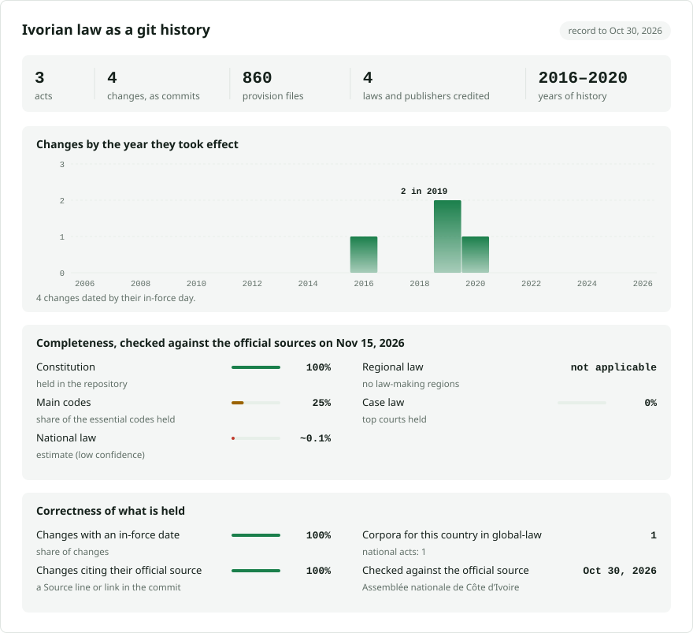

# Côte d’Ivoire: law history in git

[Français](README.md) · **English**

<picture>
<source media="(prefers-color-scheme: dark)" srcset="data/effort-dark.svg">

</picture>

The law of Côte d’Ivoire as a git history: one file per article, one commit per version on the day it took effect, and the law that made each change as the commit's author. `git blame` names the law behind every paragraph; `git log` lists every change to an article; picking a date gives the text in force that day.

Part of [lexifina/global-law](https://github.com/lexifina/global-law), one git history for every country's law: this is Côte d’Ivoire's national law, which global-law reads at `cote-divoire/national/acts/`.

**What is in it now:** the Constitution of 8 November 2016 (Loi n° 2016-886), its preamble and 184 articles, as promulgated and as revised by Loi constitutionnelle n° 2020-348 of 19 March 2020; 11 codes in `codes/` (among them the 2019 Code pénal and the mining, forest, customs, water, investment and public procurement codes); and laws, ordinances, decrees and orders from 1961 to 2025 (53 laws, 23 ordinances, 223 decrees, 126 orders (arrêtés)), among them the 2019 marriage and succession laws, one folder per text, one file per article. In `uemoa/`, 5 UEMOA acts that apply in Côte d’Ivoire. See [STRUCTURE.md](STRUCTURE.md) and `corpus.json`. Each text's folder `README.md` gives its source and date.

**Not today's Code pénal.** Laws that have amended it since 2019, among them Loi n° 2021-893 of 21 December 2021, are not applied (see [What it does not show](#what-it-does-not-show)), so the Code shows its 2019 wording.

Each act is a folder with one file per article, `art-<number>.md` (`constitution/art-055.md` is Article 55 of the Constitution, the election of the President and the Vice-President); the preamble is `constitution/preambule.md`, and `codes/code-penal/plan.md` and `lois/2019/2019-570-relative-au-mariage/plan.md` name the article each Livre, Titre, Chapitre and Section heading precedes.

The text is in French, the official language, as its publishers print it.

## Questions as git commands

| Question | Command |
| --- | --- |
| Every change to Article 55 of the Constitution (the President and the Vice-President) | `git log -p --word-diff -- constitution/art-055.md` |
| Which law wrote each line of Article 55? | `git blame constitution/art-055.md` |
| Every version of Article 55, with the day each took effect | `git log --format="%h %(trailers:key=In-force,valueonly,separator=) %an" -- constitution/art-055.md` |
| Article 55 as in force on 1 January 2019 | `python tools/en_vigueur_au.py 2019-01-01 constitution 55` |

**Outside git**, we also host this record publicly, for free:

- **[Ask Claude about Ivorian law](https://global-law.lexifina.com/v1/try_claude?country=cote-divoire)**: opens Claude with a first question ready.
- **[Ask ChatGPT](https://global-law.lexifina.com/v1/try_chatgpt?country=cote-divoire)**: the same question in ChatGPT.
- **[Search Ivorian law on our site](https://lexifina.com/law?country=cote-divoire&q=mariage)**: a search for "mariage" (marriage), with each provision's text and its versions, no account needed.
- **[Developer REST API](https://global-law.lexifina.com/v1/search_law?query=mariage&jurisdiction=cote-divoire)**: the same search as JSON, with no key. See the [documentation here](https://lexifina.com/api/global-law).

Both assistants read the record through the free Global law connector (MCP, `https://global-law.lexifina.com/mcp`); the first time, the chat gives you the link that adds it. Ask in French or in English.

**Host it yourself easily.** All it takes is git and Python, and the tools run on your machine:

```sh
git clone --depth 1 https://github.com/lexifina/global-law && cd global-law
python3 tools/countries.py add cote-divoire/national/acts
python3 tools/law.py show 2026-01-01 cote-divoire/national/acts/constitution/art-055.md
```

Opened in Claude Code, Cursor, VS Code or Codex, the clone also starts a local MCP server with the same tools ([MCP.md](https://github.com/lexifina/global-law/blob/main/MCP.md)).

## Dates

Each commit is dated at noon, Africa/Abidjan (UTC), on the day the version took effect, and carries it in its `In-force:` trailer; the promulgation day is in `Enacted:`:

- the Constitution: the day of promulgation, as its art. 184 provides ("La présente Constitution entre en vigueur à compter du jour de sa promulgation par le Président de la République"): 8 November 2016, and 19 March 2020 for the revision, the date WIPO Lex gives for Loi constitutionnelle n° 2020-348;
- the texts taken from FAOLEX (outside `constitution/`, the Code pénal and the marriage law): the day of the text named in its title (promulgation or signature) or, failing that, the closing "Fait à Abidjan, le …"; the source does not give the Journal officiel issue (the `In-force-basis` trailer says so). A text with no reliable date is not taken;
- the Code pénal and the marriage law: the day of the Journal officiel issue that published each, 10 and 12 July 2019 (both were promulgated on 26 June 2019). Each orders that it be "publiée au Journal officiel … et exécutée comme loi de l’Etat" and sets no other date.

Each version is credited to the law that made it, with an e-mail address that cannot exist, so `git blame` and `git log --author` name laws; the committer is always Lexifina. The 2020 commit changes the 24 articles whose words Loi constitutionnelle n° 2020-348 rewrote; WIPO Lex marks two more "Nouveau" (arts. 148 and 149), which read word for word as in 2016 and are named in the commit's `Also-concerns:` trailer.

## How it is checked

- `tools/check_repo.py` reads every version back from git on the day it took effect and on the day before, and both must match the corpus the history was built from; it also checks that every commit's trailers parse and that there are no merge commits. A second build into an empty folder gave identical hashes, and new acts are appended on top of `main` without rewriting it. The results are in [`REPRODUCE.md`](REPRODUCE.md).
- The Constitution today is word for word WIPO Lex's 2020 consolidation, and every article WIPO does not mark "Nouveau" agrees word for word with the Assemblée nationale's 2016 text, apart from a few typesetting slips in WIPO's copy, where the 2016 wording is kept (each listed in `REPRODUCE.md`).
- The Code pénal and the marriage law are the Assemblée nationale's text as adopted, compared word by word with the Journal officiel issue that published each; where they differ, the gazette's wording is used: five places in the Code pénal (arts. 101, 154, 255, 308 and 362) and two in the marriage law (arts. 104 and 105).
- [vulnerabilities/](vulnerabilities/README.en.md): possible drafting mistakes in this law, found by global-law's detectors and checked by hand. Not run yet.

## What it does not show

- **The Code pénal as amended.** The laws that changed it after 2019 were not found as official texts with a text layer, so today's text may differ.
- **Earlier texts**: the Constitutions of 1960 and 2000 and the Code pénal of 1981.
- **Much other law.** The online Journal officiel (sgg.gouv.ci) needs a login and is not used; the texts come from FAOLEX's (FAO) copies of the national PDFs and from PDFs published by official sites (SGG, ARCOP, ARTCI, AFOR, HABG, HACA, Customs, CNPS, Treasury, Environment, Conseil constitutionnel; see the sources), taken only where the PDF has a readable, complete text layer (we do no OCR). Still missing, among others: the 2018 Code de procédure pénale, the Code civil, the 2015 Code du travail (the Journal officiel text layer is out of reading order), the filiation and minority laws and Loi n° 2013-450 (scans). Each text is recorded as published, in one version; later amendments are not replayed yet. Conseil constitutionnel decisions, Cour de cassation, Tribunal de commerce d’Abidjan and ARCOP (formerly ANRMP) decisions and OHADA case law are in the private `cote-divoire-law-caselaw` repository.
- **When the Constitution's laws were published.** Their Journal officiel issues were not found, so the 2016 and 2020 versions carry their promulgation dates only.
- **Headings and formulas.** Titre, Chapitre and Section headings are not in the article files, and the promulgation formula and signatures are left out.

## Sources

| Source | Kind | Past versions | Notes |
| --- | --- | --- | --- |
| [Assemblée nationale](https://www.assnat.ci/?-la-constitution-) | The Constitution as promulgated, PDF with a text layer | no, the 2016 text | Version 1 of the Constitution |
| [WIPO Lex, record CI023](https://www.wipo.int/wipolex/fr/legislation/details/22491) | The Constitution as revised by Loi constitutionnelle n° 2020-348, each rewritten article marked "Nouveau" | no, the 2020 text | Version 2, its date and its credits |
| Assemblée nationale: [Code pénal](https://www.assnat.ci/?loi-portant-code-penal), [marriage law](https://www.assnat.ci/?loi-relatif-au-mariage) | The two laws as adopted, PDFs with a text layer | no, as adopted | Their words |
| [FAOLEX](https://faolex.fao.org) (FAO) | Copies of national PDFs (Journal officiel, ministries) | no, one version each | Codes, laws, ordinances, decrees and orders other than the three texts above; commits carry `Source-status: secondary copy` |
| Ivorian official sites: [SGG documenthèque](https://www.sgg.gouv.ci/documentheque.php?id_cas=2), [ARCOP regulations](https://arcop.ci/documentation/reglementation/), [ARTCI legal texts](https://artci.ci/textes-juridiques/lois/), [AFOR](https://www.afor.ci/textes-juridiques/lois), [HABG](https://www.habg.ci/bibliotheque), [HACA](https://www.haca.ci/la-haca/textes-juridiques), [Customs](https://www.douanes.ci/info/textes-reglementaires), [CNPS](https://www.cnps.ci/services-en-ligne/textes-legaux-et-reglementaires/), [Treasury](https://tresor.gouv.ci/tres/textes-referentiels/), [Environment](https://www.environnement.gouv.ci/publications/sous-categorie/36), [Conseil constitutionnel](https://www.conseil-constitutionnel.ci/lois-et-decrets/lois-organiques) | PDFs of texts published by the body that applies them (text layer) | no, one version each | Laws, ordinances, decrees and orders missing from FAOLEX or unreadable in its copy; dated like the FAOLEX texts; official source (no `Source-status` trailer) |
| [WIPO Lex](https://www.wipo.int/wipolex/en/members/profile/CI) (WIPO) | Copies of national texts | no | Intellectual-property laws and decrees; `Source-status: secondary copy` |
| [UEMOA Commission](https://www.uemoa.int/les-actes) | Community acts (PDF) | no | `uemoa/`: acts whose entry-into-force day can be read in the text (signature or a set date) |
| Journal officiel n° 9 spécial (10 July 2019) and n° 10 spécial (12 July 2019), copies on the site of the [Ministère de la Femme, de la Famille et de l’Enfant](https://www.famille.gouv.ci) | The two laws as promulgated (scans) | no, as published | Their numbers and dates, and the word-by-word check |

## Licence

See [`LICENSE`](LICENSE). The texts are official legal texts of the Republic of Côte d’Ivoire, reproduced with attribution to the Assemblée nationale, WIPO Lex, the Journal officiel and FAOLEX (FAO); the Assemblée nationale states no licence for them, WIPO Lex reproduces them for information under WIPO's general terms of use, and their copyright status is not confirmed here. The history, commit messages, tables and tools are CC0 1.0.

No AI model wrote, translated or corrected legal text, and none runs when the history is built; the scripts were written by an AI model (see [`REPRODUCE.md`](REPRODUCE.md)).

## Visualisations

- [visualisations/](visualisations/README.en.md): charts drawn from this repository. Not drawn yet.

## More

From [lexifina/global-law](https://github.com/lexifina/global-law):

- [FEATURES.md](https://github.com/lexifina/global-law/blob/main/FEATURES.md): every feature, and what every corpus must support (`git blame`, `law.py`, the MCP tools)
- [FAQ.md](https://github.com/lexifina/global-law/blob/main/FAQ.md): questions and answers · [CONTRIBUTING.md](https://github.com/lexifina/global-law/blob/main/CONTRIBUTING.md): proposing changes · [MCP.md](https://github.com/lexifina/global-law/blob/main/MCP.md): the MCP server · [REPRODUCE.md](https://github.com/lexifina/global-law/blob/main/REPRODUCE.md): how it was built · [CHANGELOG.md](https://github.com/lexifina/global-law/blob/main/CHANGELOG.md)
- [FRESHNESS.md](https://github.com/lexifina/global-law/blob/main/FRESHNESS.md): how current each corpus is · [Monitoring](https://github.com/lexifina/global-law/tree/main/monitoring): whether updates are running · [WATCHING.md](https://github.com/lexifina/global-law/blob/main/WATCHING.md): how each official source is watched for changes
- [performance/](https://github.com/lexifina/global-law/tree/main/performance): how fast the tools are, measured
- [visualisations/](https://github.com/lexifina/global-law/tree/main/visualisations): charts and bridges across the world's law
- [Vulnerabilities](https://github.com/lexifina/global-law/tree/main/vulnerabilities): mistakes in legislation as published
