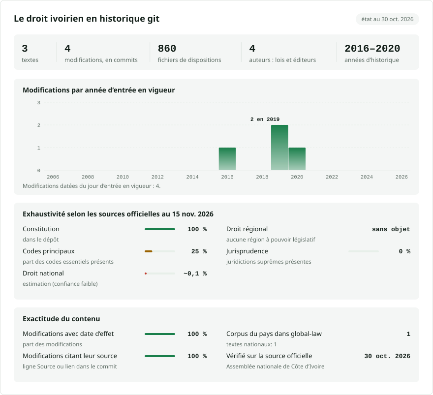

# Côte d’Ivoire : l’historique du droit dans git

**Français** · [English](README.en.md)

<picture>
<source media="(prefers-color-scheme: dark)" srcset="data/fr/effort-dark.svg">

</picture>

Le droit ivoirien sous forme d’historique git : un fichier par article, un commit par version au jour de son entrée en vigueur, et pour auteur de chaque commit la loi qui a apporté la modification. `git blame` désigne la loi à l’origine de chaque alinéa ; `git log` énumère toutes les modifications d’un article ; le choix d’une date donne le texte en vigueur ce jour-là.

Fait partie de [lexifina/global-law](https://github.com/lexifina/global-law), un historique git unique pour le droit de chaque pays : ce dépôt contient le droit national ivoirien, que global-law lit dans `cote-divoire/national/acts/`.

**Contenu actuel :** la Constitution du 8 novembre 2016 (loi n° 2016-886), son préambule et ses 184 articles, telle que promulguée et telle que révisée par la loi constitutionnelle n° 2020-348 du 19 mars 2020 ; 11 codes dans `codes/` (dont le Code pénal de 2019, les codes minier, forestier, des douanes, de l’eau, des investissements et des marchés publics) ; et des lois, ordonnances, décrets et arrêtés de 1961 à 2025 (47 lois, 27 ordonnances, 237 décrets, 132 arrêtés), dont la loi relative au mariage et la loi relative aux successions de 2019, un dossier par texte, un fichier par article. Dans `uemoa/`, 5 actes de l’UEMOA applicables en Côte d’Ivoire. Voir [STRUCTURE.md](STRUCTURE.md) et `corpus.json`. Le `README.md` du dossier de chaque texte en donne la source et la date.

**Ce n’est pas le Code pénal en vigueur aujourd’hui.** Les lois qui l’ont modifié depuis 2019, dont la loi n° 2021-893 du 21 décembre 2021, ne sont pas appliquées (voir [Ce qu’il ne montre pas](#ce-quil-ne-montre-pas)) ; le Code présente donc sa rédaction de 2019.

Chaque texte est un dossier comportant un fichier par article, `art-<number>.md` (`constitution/art-055.md` est l’article 55 de la Constitution, relatif à l’élection du Président et du Vice-Président de la République) ; le préambule est `constitution/preambule.md`, et `codes/code-penal/plan.md` et `lois/2019/2019-570-relative-au-mariage/plan.md` indiquent l’article que précède chaque intitulé de Livre, Titre, Chapitre et Section.

Le texte est en français, la langue officielle, tel que l’impriment ses éditeurs.

## Questions sous forme de commandes git

| Question | Commande |
| --- | --- |
| Toutes les modifications de l’article 55 de la Constitution (le Président et le Vice-Président) | `git log -p --word-diff -- constitution/art-055.md` |
| Quelle loi a écrit chaque ligne de l’article 55 ? | `git blame constitution/art-055.md` |
| Toutes les versions de l’article 55, avec le jour d’entrée en vigueur de chacune | `git log --format="%h %(trailers:key=In-force,valueonly,separator=) %an" -- constitution/art-055.md` |
| L’article 55 tel qu’en vigueur le 1er janvier 2019 | `python tools/en_vigueur_au.py 2019-01-01 constitution 55` |

**En dehors de git**, nous hébergeons aussi ce registre publiquement, gratuitement :

- **[Interroger Claude sur le droit ivoirien](https://global-law.lexifina.com/v1/try_claude?country=cote-divoire)** : ouvre Claude avec une première question prête.
- **[Interroger ChatGPT](https://global-law.lexifina.com/v1/try_chatgpt?country=cote-divoire)** : la même question dans ChatGPT.
- **[Rechercher dans le droit ivoirien sur notre site](https://lexifina.com/law?country=cote-divoire&q=mariage)** : une recherche de « mariage », avec le texte de chaque disposition et ses versions, sans compte.
- **[API REST pour les développeurs](https://global-law.lexifina.com/v1/search_law?query=mariage&jurisdiction=cote-divoire)** : la même recherche en JSON, sans clé. Voir la [documentation ici](https://lexifina.com/api/global-law).

Les deux assistants lisent le registre au moyen du connecteur gratuit Global law (MCP, `https://global-law.lexifina.com/mcp`) ; la première fois, la conversation vous donne le lien qui l’ajoute. Posez vos questions en français ou en anglais.

**L’héberger vous-même, simplement.** Il suffit de git et de Python, et les outils s’exécutent sur votre machine :

```sh
git clone --depth 1 https://github.com/lexifina/global-law && cd global-law
python3 tools/countries.py add cote-divoire/national/acts
python3 tools/law.py show 2026-01-01 cote-divoire/national/acts/constitution/art-055.md
```

Ouvert dans Claude Code, Cursor, VS Code ou Codex, le clone lance aussi un serveur MCP local doté des mêmes outils ([MCP.md](https://github.com/lexifina/global-law/blob/main/MCP.md)).

## Dates

Chaque commit est daté à midi, heure d’Abidjan (Africa/Abidjan, UTC), du jour où la version est entrée en vigueur, et porte ce jour dans son trailer `In-force:` ; le jour de la promulgation figure dans `Enacted:` :

- la Constitution : le jour de sa promulgation, comme le prévoit son article 184 (« La présente Constitution entre en vigueur à compter du jour de sa promulgation par le Président de la République ») : le 8 novembre 2016, et le 19 mars 2020 pour la révision, date que WIPO Lex indique pour la loi constitutionnelle n° 2020-348 ;
- les textes tirés de FAOLEX (hors de `constitution/`, du Code pénal et de la loi relative au mariage) : le jour du texte nommé dans son intitulé (promulgation ou signature) ou, à défaut, le « Fait à Abidjan, le … » final ; le numéro du Journal officiel n’est pas donné par la source (le trailer `In-force-basis` le dit). Un texte sans date sûre n’est pas repris ;
- le Code pénal et la loi relative au mariage : le jour du numéro du Journal officiel qui a publié chacun d’eux, les 10 et 12 juillet 2019 (tous deux ont été promulgués le 26 juin 2019). Chacun dispose que la loi sera « publiée au Journal officiel … et exécutée comme loi de l’Etat » et ne fixe aucune autre date.

Chaque version est attribuée à la loi qui l’a faite, avec une adresse électronique qui ne peut pas exister, de sorte que `git blame` et `git log --author` nomment des lois ; le committer est toujours Lexifina. Le commit de 2020 modifie les 24 articles dont la loi constitutionnelle n° 2020-348 a réécrit les termes ; WIPO Lex en marque deux autres « Nouveau » (art. 148 et 149), dont la rédaction est identique mot pour mot à celle de 2016 et qui sont nommés dans le trailer `Also-concerns:` du commit.

## Comment il est vérifié

- `tools/check_repo.py` relit chaque version depuis git au jour de son entrée en vigueur et la veille, et les deux doivent correspondre au corpus à partir duquel l’historique a été construit ; il vérifie aussi que les trailers de chaque commit se lisent sans erreur et qu’il n’existe aucun commit de fusion. Une seconde construction dans un dossier vide a donné des empreintes identiques, et les nouveaux textes sont ajoutés au-dessus de `main` sans le réécrire. Les résultats figurent dans [`REPRODUCE.md`](REPRODUCE.md).
- La Constitution actuelle reproduit mot pour mot la version consolidée de 2020 de WIPO Lex, et chaque article que WIPO ne marque pas « Nouveau » concorde mot pour mot avec le texte de 2016 de l’Assemblée nationale, à l’exception de quelques coquilles typographiques de la copie de WIPO, pour lesquelles la rédaction de 2016 est conservée (chacune est énumérée dans `REPRODUCE.md`).
- Le Code pénal et la loi relative au mariage sont le texte de l’Assemblée nationale tel qu’adopté, comparé mot à mot avec le numéro du Journal officiel qui a publié chacun d’eux ; en cas de divergence, la rédaction du Journal officiel est retenue : à cinq endroits du Code pénal (art. 101, 154, 255, 308 et 362) et à deux endroits de la loi relative au mariage (art. 104 et 105).
- [vulnerabilities/](vulnerabilities/): erreurs de rédaction possibles dans ce droit, trouvées par les détecteurs de global-law et vérifiées à la main. Pas encore lancé.

## Ce qu’il ne montre pas

- **Le Code pénal tel que modifié.** Les lois qui l’ont modifié après 2019 n’ont pas été trouvées sous forme de textes officiels dotés d’une couche texte ; le texte actuel peut donc différer.
- **Les textes antérieurs** : les Constitutions de 1960 et de 2000 et le Code pénal de 1981.
- **Beaucoup d’autres textes.** Le Journal officiel en ligne (sgg.gouv.ci) exige une connexion et n’est pas utilisé ; les textes viennent de la copie FAOLEX (FAO) des PDF nationaux et des PDF que publient des sites officiels (SGG, ARCOP, ARTCI, AFOR, HABG, HACA, Douanes, CNPS, Trésor, Environnement, Conseil constitutionnel ; voir les sources), repris seulement quand le PDF a une couche texte lisible et complète (nous ne faisons pas d’OCR). Restent donc hors du dépôt, entre autres, le Code de procédure pénale de 2018, le Code civil, le Code du travail de 2015 (couche texte du Journal officiel dans le désordre), les lois sur la filiation et la minorité et la loi n° 2013-450 (numérisations). Chaque texte est enregistré tel que publié, en une version ; les modifications ultérieures ne sont pas encore rejouées. Les décisions du Conseil constitutionnel, de la Cour de cassation, du Tribunal de commerce d’Abidjan, de l’ARCOP (ex-ANRMP) et la jurisprudence OHADA sont dans le dépôt privé `cote-divoire-law-caselaw`.
- **La date de publication des lois relatives à la Constitution.** Les numéros du Journal officiel correspondants n’ont pas été trouvés ; les versions de 2016 et de 2020 ne portent donc que leur date de promulgation.
- **Les intitulés et les formules.** Les intitulés de Titre, Chapitre et Section ne figurent pas dans les fichiers des articles, et la formule de promulgation et les signatures sont omises.

## Sources

| Source | Nature | Versions antérieures | Remarques |
| --- | --- | --- | --- |
| [Assemblée nationale](https://www.assnat.ci/?-la-constitution-) | La Constitution telle que promulguée, PDF doté d’une couche texte | non, le texte de 2016 | Version 1 de la Constitution |
| [WIPO Lex, notice CI023](https://www.wipo.int/wipolex/fr/legislation/details/22491) | La Constitution telle que révisée par la loi constitutionnelle n° 2020-348, chaque article réécrit étant marqué « Nouveau » | non, le texte de 2020 | La version 2, sa date et ses attributions |
| Assemblée nationale : [Code pénal](https://www.assnat.ci/?loi-portant-code-penal), [loi relative au mariage](https://www.assnat.ci/?loi-relatif-au-mariage) | Les deux lois telles qu’adoptées, PDF dotés d’une couche texte | non, telles qu’adoptées | Leurs termes |
| [FAOLEX](https://faolex.fao.org) (FAO) | Copies des PDF nationaux (Journal officiel, ministères) | non, une version chacun | Codes, lois, ordonnances, décrets et arrêtés hors des trois textes ci-dessus ; commits `Source-status: secondary copy` |
| Sites officiels ivoiriens : [SGG, documenthèque](https://www.sgg.gouv.ci/documentheque.php?id_cas=2), [ARCOP, réglementation](https://arcop.ci/documentation/reglementation/), [ARTCI, textes juridiques](https://artci.ci/textes-juridiques/lois/), [AFOR](https://www.afor.ci/textes-juridiques/lois), [HABG](https://www.habg.ci/bibliotheque), [HACA](https://www.haca.ci/la-haca/textes-juridiques), [Douanes](https://www.douanes.ci/info/textes-reglementaires), [CNPS](https://www.cnps.ci/services-en-ligne/textes-legaux-et-reglementaires/), [Trésor](https://tresor.gouv.ci/tres/textes-referentiels/), [Environnement](https://www.environnement.gouv.ci/publications/sous-categorie/36), [Conseil constitutionnel](https://www.conseil-constitutionnel.ci/lois-et-decrets/lois-organiques) | PDF des textes publiés par l’administration qui les applique (couche texte) | non, une version chacun | Lois, ordonnances, décrets et arrêtés absents de FAOLEX ou illisibles dans sa copie ; datés comme les textes FAOLEX ; source officielle (pas de trailer `Source-status`) |
| [WIPO Lex](https://www.wipo.int/wipolex/fr/members/profile/CI) (OMPI) | Copies de textes nationaux | non | Lois et décrets de propriété intellectuelle ; trailer `Source-status: secondary copy` |
| [Commission de l’UEMOA](https://www.uemoa.int/les-actes) | Actes communautaires (PDF) | non | `uemoa/` : actes dont la date d’entrée en vigueur se lit dans le texte (signature ou date fixée) |
| Journal officiel n° 9 spécial (10 juillet 2019) et n° 10 spécial (12 juillet 2019), copies sur le site du [Ministère de la Femme, de la Famille et de l’Enfant](https://www.famille.gouv.ci) | Les deux lois telles que promulguées (numérisations) | non, telles que publiées | Leurs numéros et dates, et la vérification mot à mot |

## Licence

Voir [`LICENSE`](LICENSE). Les textes sont des textes juridiques officiels de la République de Côte d’Ivoire, reproduits avec mention de l’Assemblée nationale, de WIPO Lex, du Journal officiel et de FAOLEX (FAO) comme source ; l’Assemblée nationale n’indique aucune licence pour ces textes, WIPO Lex les reproduit à titre d’information conformément aux conditions générales d’utilisation de l’OMPI, et leur statut au regard du droit d’auteur n’est pas confirmé ici. L’historique, les messages de commit, les tableaux et les outils sont sous CC0 1.0.

Aucun modèle d’IA n’a écrit, traduit ou corrigé de texte juridique, et aucun n’est exécuté lors de la construction de l’historique ; les scripts ont été écrits par un modèle d’IA (voir [`REPRODUCE.md`](REPRODUCE.md)).

Ceci est une traduction de la version anglaise ([README.en.md](README.en.md)) ; en cas de divergence, la version anglaise fait foi.

## Visualisations

- [visualisations/](visualisations/): graphiques tirés de ce dépôt. Pas encore dessinés.

## En savoir plus

Dans le dépôt [lexifina/global-law](https://github.com/lexifina/global-law) (pages en anglais) :

- [FEATURES.md](https://github.com/lexifina/global-law/blob/main/FEATURES.md): toutes les fonctionnalités et ce que chaque corpus doit prendre en charge (`git blame`, `law.py`, outils MCP)
- [FAQ.md](https://github.com/lexifina/global-law/blob/main/FAQ.md): questions et réponses · [CONTRIBUTING.md](https://github.com/lexifina/global-law/blob/main/CONTRIBUTING.md): proposer une modification · [MCP.md](https://github.com/lexifina/global-law/blob/main/MCP.md): serveur MCP · [REPRODUCE.md](https://github.com/lexifina/global-law/blob/main/REPRODUCE.md): comment il a été construit · [CHANGELOG.md](https://github.com/lexifina/global-law/blob/main/CHANGELOG.md)
- [FRESHNESS.md](https://github.com/lexifina/global-law/blob/main/FRESHNESS.md): à quel point chaque corpus est à jour · [Surveillance](https://github.com/lexifina/global-law/tree/main/monitoring): si les mises à jour fonctionnent · [WATCHING.md](https://github.com/lexifina/global-law/blob/main/WATCHING.md): comment chaque source officielle est surveillée pour repérer les modifications
- [performance/](https://github.com/lexifina/global-law/tree/main/performance): la rapidité des outils, mesurée
- [visualisations/](https://github.com/lexifina/global-law/tree/main/visualisations): graphiques et liens à travers le droit du monde entier
- [Vulnérabilités](https://github.com/lexifina/global-law/tree/main/vulnerabilities): erreurs dans les textes tels qu’ils ont été publiés
